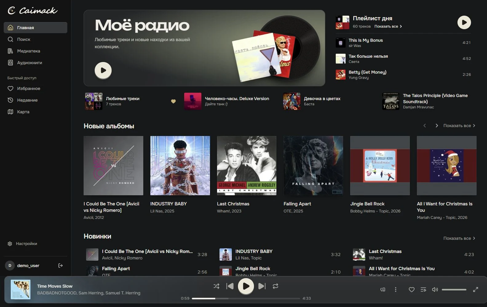

<p align="center">
  
</p>

<h1 align="center">Caimack</h1>

<p align="center"><strong>Stream your own music collection from your own server.</strong></p>

<p align="center">
  <a href="https://bulatruslanovich.github.io/caimack/">Website</a> ·
  <a href="#quick-start">Quick start</a> ·
  <a href="docs/README.md">Documentation</a> ·
  <a href="https://github.com/BulatRuslanovich/caimack/releases">App downloads</a>
</p>

<p align="center">
  
</p>

## Quick start

Use a host with Bash, Docker and Compose v2. Point a domain at the server and make
ports 80 and 443 reachable for the default Caddy HTTPS setup.

```bash
git clone https://github.com/BulatRuslanovich/caimack.git
cd caimack
./caimack.sh
```

1. Enter the domain, the path to your music folder, and the owner username. The
   manager generates secrets, starts the containers, and displays the initial
   credentials.
2. Open `https://<your-domain>` and sign in. Caimack mounts your music folder
   read-only by default and scans it for tracks. Add more music from **Upload**.
3. To share the server, open **Users** and create a one-time invitation link.
   Each person chooses their own username and password.

Run `./caimack.sh` again to open the server console. See the
[server manager guide](docs/server-manager.md) for standalone installation, manual
Compose setup, upgrades, and password recovery.

## Why Caimack

- **A library built around your files.** Stream MP3 and FLAC, browse by artist or
  album, and organize saved albums, artists, and playlists in nested folders.
  Audio and listening history live on your server.
- **A player for whole albums.** Listen gaplessly, seek on the waveform, and follow
  [synchronized lyrics](docs/lyrics.md) when a matching source provides them.
- **A collection that travels.** Download music on Android or desktop, and resume
  [audiobooks](docs/audiobooks.md) from your last position on another device.
- **Radio from your own library.** The optional
  [MERT module](docs/mert.md) uses a supported GPU to power personal radio, mixes,
  and the [library map](docs/library-map.md). The standard deployment runs without a GPU.

## Listen on your devices

### On the phone

Open Caimack in a browser to use the mobile web app, or install the native Android
app for background playback, Android Auto, and offline music.

- [Download tracks, albums, and playlists](docs/android-downloads.md).
- [Synchronize your entire music library over your home network](docs/android-library-sync.md).
- [Connect Android to a local HTTP endpoint](docs/android-local-http.md).

Get the ARM64 APK for Android 13 or later from
[GitHub Releases](https://github.com/BulatRuslanovich/caimack/releases).

### On Windows and Linux

Download an installer or portable package from
[GitHub Releases](https://github.com/BulatRuslanovich/caimack/releases).
See the [desktop guide](docs/desktop.md) for downloads, library sync, and tray playback.

### Control a connected device

Sign in to the same account on both devices to control a connected player from
the web or Android app. Open the device selector in the player, choose an online
receiver, and select **This device** to bring playback back.

## A look around

[Full-screen player](docs/screenshots/landing/player.webp) ·
[Album view](docs/screenshots/landing/album.webp) ·
[Mobile web player](docs/screenshots/landing/mobile-player.webp) ·
[Android player](docs/screenshots/landing/android-player.webp)

## Documentation

| I want to… | Start here |
| --- | --- |
| Set up, update, or recover a server | [Server manager](docs/server-manager.md) |
| Keep listening offline | [Android downloads](docs/android-downloads.md) or [desktop](docs/desktop.md) |
| Add books, manage lyrics, or change how files are stored | [Library guides](docs/README.md#music-library) |
| Import from Yandex Music or VK Music | [Music provider imports](docs/README.md#import-from-music-services) |
| Enable radio, mixes, or the map | [Recommendations with MERT](docs/mert.md) |
| Diagnose a server issue | [Backend logging](docs/backend-logging.md) or [LAN monitoring](deploy/monitoring/README.md) |
| Find every guide | [Documentation index](docs/README.md) |

## Under the hood

Caddy serves the Next.js client and Rust API over HTTPS. The API keeps catalog,
accounts, and listening history in PostgreSQL. Background workers process music
from local storage and use MERT when recommendations are enabled.
[Architecture and source layout](docs/development.md#architecture)

## Development

Use the [development guide](docs/development.md) to run the web and API locally,
build the clients, or run tests. See [CONTRIBUTING.md](CONTRIBUTING.md) before
sending a pull request and the [release guide](docs/releases.md) for packaging.

## License

Caimack is licensed under [AGPL-3.0-only](LICENSE).
