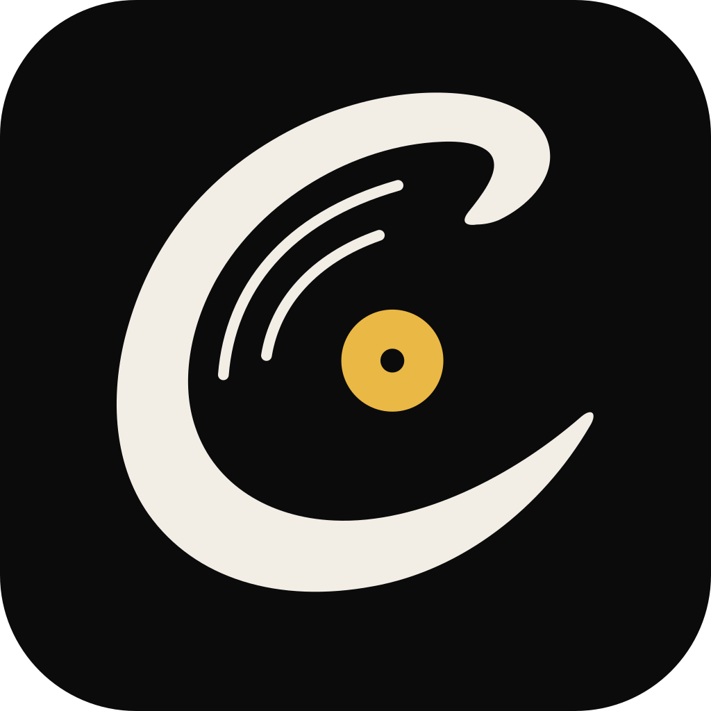
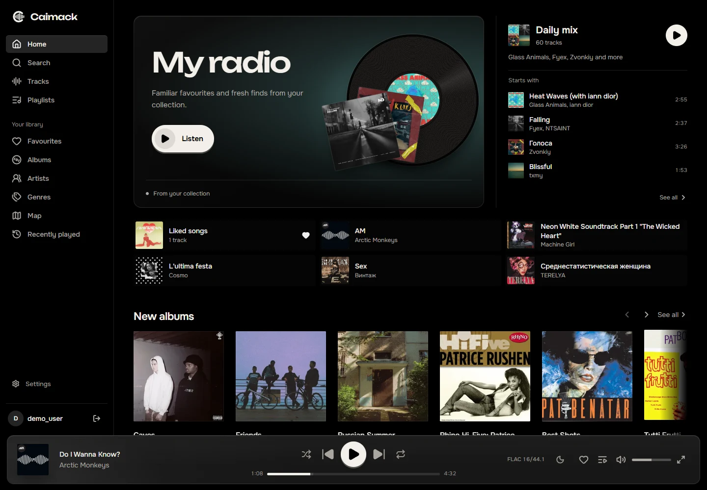
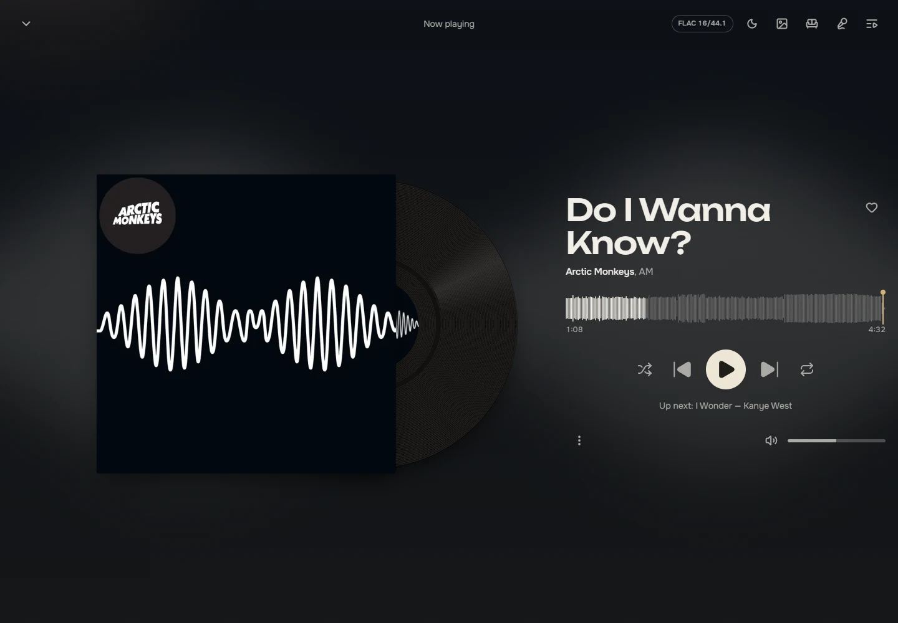
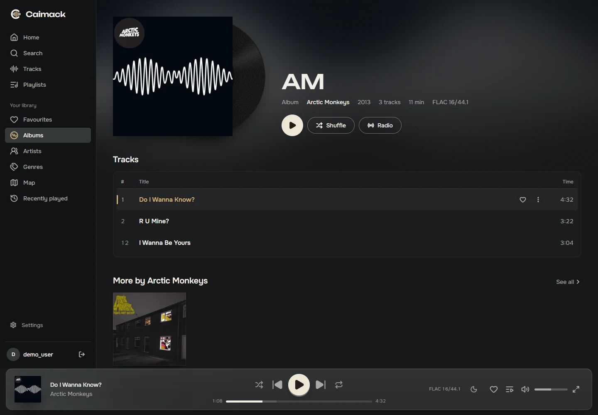
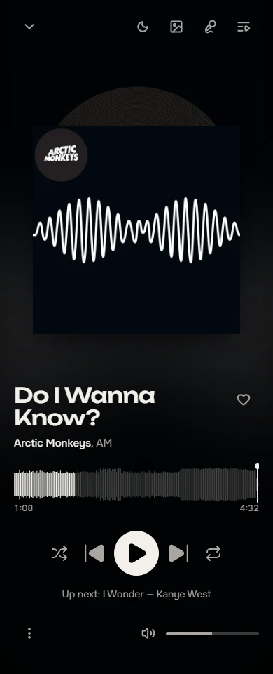
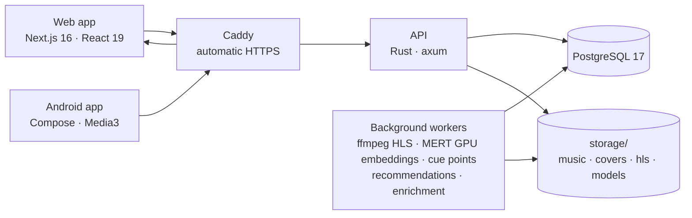

<p align="center">
  
</p>

<h1 align="center">Caimack</h1>

<p align="center"><strong>Your music. Your server. Your next favourite.</strong></p>

<p align="center">
  A personal streaming service for your music collection,<br>
  with recommendations that run on your own hardware.
</p>

<p align="center">
  <a href="#quick-start"></a>
  <a href="#on-the-phone"></a>
  <a href="LICENSE"></a>
</p>

<p align="center">
  <a href="#why-caimack">Why Caimack</a> ·
  <a href="#a-look-around">Screenshots</a> ·
  <a href="#quick-start">Get started</a> ·
  <a href="#development">Development</a>
</p>

<p align="center">
  
</p>

Caimack gives your MP3 and FLAC collection a home of its own. Connect your music folder or upload
albums, invite the people you trust, and press play. Your server takes care of the library, the
listening history and the recommendations.

## Why Caimack

<table>
  <tr>
    <td width="50%" valign="top">
      <h3>A radio that pays attention</h3>
      <p>Radio learns from your listening history and adapts to your current session.
      Local audio analysis connects tracks by their sound, powering recommendations and
      an explorable map of your collection.</p>
    </td>
    <td width="50%" valign="top">
      <h3>Your collection stays yours</h3>
      <p>Keep the original files and connect your existing music folder read-only.
      Your listening history lives in your own database; audio analysis and recommendation
      ranking run on your hardware.</p>
    </td>
  </tr>
  <tr>
    <td width="50%" valign="top">
      <h3>A player with character</h3>
      <p>Cover colours, a spinning record and synced lyrics give the music a place on screen.
      Albums flow without gaps, and carefully timed transitions keep the queue
      moving naturally.</p>
    </td>
    <td width="50%" valign="top">
      <h3>At home and on the move</h3>
      <p>Listen in a browser or the native Android app. Take albums offline on your phone,
      then pick up a session on another device with your place in the track intact.</p>
    </td>
  </tr>
</table>

One Docker Compose setup brings up the app, database and HTTPS. No external account is required.

## A look around

A few screens from the live web client, in **OLED Black** and **Coffee**.
The home screen above brings together personal radio, a daily mix and new additions to the library.

<p align="center">
  
</p>

<p align="center"><sub>Coffee · The full-screen player takes its colours from the cover art.</sub></p>

<p align="center">
  
</p>

<p align="center"><sub>Coffee · Albums, track lists and more from the same artist.</sub></p>

### On the phone

The web app is a PWA with its own mobile layout. There is also a native Android client with
background playback, offline downloads and Android Auto.

The normal player can also control another signed-in web or Android device.
Choose an output from the player's device button; playback controls, the queue
and progress follow that device. See [playback devices](docs/playback-connect.md).

<p align="center">
  
</p>

<p align="center"><sub>OLED Black · The same player, made for a smaller screen.</sub></p>

## Quick start

You'll need Docker with Compose v2 and a domain pointing at your server.

```bash
git clone https://github.com/BulatRuslanovich/caimack.git
cd caimack
./caimack.sh
```

On its first run the manager asks for your domain, music folder and admin username,
generates secrets and starts the prebuilt images from `ghcr.io`. Later runs open
an interactive server console with arrow-key navigation and direct shortcuts.
The entire manager is in English; no extra TUI packages are required.

```bash
./caimack.sh update                  # pull images and apply updates
./caimack.sh recommendations on      # opt in to MERT; auto-detect NVIDIA / AMD
./caimack.sh recommendations off     # return to the CPU-only deployment
./caimack.sh reset once              # recover the owner password
./caimack.sh status
```

Configuration changes are backed up in `.caimack/backups/`. Existing database and
JWT secrets are preserved. `setup.sh` remains a compatibility entry point.
See the [server manager guide](docs/server-manager.md) for standalone installation,
all commands and password reset behaviour.

Open `https://<PUBLIC_DOMAIN>` and sign in as the owner: the music folder is scanned on its
own, and more music can be dropped onto the Upload page. Invite people from the Users page: each
invitation is a one-time link that lets them pick a username and a password.

<details>
<summary>Music folders & first-run analysis</summary>

The music folder is rescanned every hour (`LIBRARY_SCAN_INTERVAL_MINUTES`, `0` for manual only)
and from the Upload page. A file that disappears stays in the library for 30 days, so a drive that
is briefly disconnected costs no likes or history; a moved file keeps its track.

Recommendations are optional and disabled by default: no GPU, MERT image or weights
are required for a normal deployment. Add `-f docker-compose.recommendations.yml`
after your usual Compose files to enable the module. The API advertises this
capability; clients hide recommendation controls when it is disabled.

When enabled, track similarity uses **MERT-Large v1 (330M)** on an NVIDIA (CUDA) or supported AMD (ROCm) GPU. The `mert` container
downloads the pinned, ready-to-use weights (about 1.26 GB) from Hugging Face once
and keeps them in `storage/models/mert`. No training or model export runs on the server.
The library and playback are available while the model loads. Existing CLAP vectors
are automatically replaced in the background; recommendations and the map use only
compatible MERT vectors.

See [optional module deployment and cache reuse](docs/mert.md).

Listening behavior automatically scores recommendations; see [recommendation quality](docs/recommendations.md).

</details>

<details>
<summary>Manual setup & updates</summary>

To set it up by hand, copy `.env.example` to `.env` and fill in:

```env
POSTGRES_PASSWORD=   # openssl rand -hex 32 (it goes into a URL, so no special characters)
JWT_SIGNING_KEY=     # openssl rand -base64 48
OWNER_PASSWORD=      # password for the first admin account
PUBLIC_DOMAIN=       # domain for the automatic HTTPS certificate
MUSIC_LIBRARY_PATH=  # optional: a folder with your music, mounted read-only (default ./library)
COMPOSE_FILE=docker-compose.yml:docker-compose.images.yml   # use the prebuilt images; leave out to build
```

Then run `docker compose up -d`. To update, run `docker compose pull && docker compose up -d`;
`CAIMACK_VERSION` pins a release instead of `latest`.

Use `./caimack.sh install --build` for a source-based installation, or
`./caimack.sh --help` for the non-interactive options.

</details>

## Under the hood

<details>
<summary>Architecture, stack & source layout</summary>



| Part        | What it does                                                                                                                                                                                                                                                                                                            |
| ----------- | ----------------------------------------------------------------------------------------------------------------------------------------------------------------------------------------------------------------------------------------------------------------------------------------------------------------------- |
| `backend/`  | Rust API (axum, sqlx). Workers transcode uploads to HLS, analyse cue points and tempo, send audio fragments to the local MERT GPU service, and look up lyrics (LRCLIB) and artist photos (Deezer). Recommendations and the library map use an in-memory embedding snapshot; sound duplicate detection uses Chromaprint. |
| `frontend/` | Next.js app with TanStack Query and hls.js. A service worker caches the shell, artwork and stream segments.                                                                                                                                                                                                             |
| `android/`  | Kotlin client using Jetpack Compose and Media3: background playback, downloads, Android Auto and a quick-settings radio tile.                                                                                                                                                                                           |
| `db/`       | The database schema as numbered SQL migrations, applied by `caimack migrate` (the `migrate` service in Compose); the server only checks that the schema is current. See [db/README.md](db/README.md).                                                                                                                   |
| `deploy/`   | Caddyfile for the reverse proxy.                                                                                                                                                                                                                                                                                        |

</details>

## Development

You'll need Rust 1.94+, ffmpeg on `PATH`, Node.js, Docker and, for the Android client, the Android SDK.

```bash
cp backend/.env.example backend/.env   # then set JWT_SIGNING_KEY and OWNER_PASSWORD
make backend
make frontend
```

`make help` lists everything. Before a push, run `make check` for formatting, lint and the Rust/web
tests, and `make test-db` for the PostgreSQL integration checks used by CI. SQL in the backend is checked against the database at
compile time; after changing a query, run `make sqlx` so builds without a database (CI,
Docker) see it.

`make test-db` runs the Rust tests with PostgreSQL, including session revocation, catalog filters,
history validation and background job recovery. CI runs this group automatically using
`cargo test --workspace --all-features --locked`. The two tests that contact the real Deezer and
LRCLIB services remain opt-in. Plain `cargo test --workspace --locked` also works without a database
when compiled with `SQLX_OFFLINE=true`.

Playback clients include accumulated `listenedSeconds` alongside `playbackPosition` in
`POST /api/history`; seeking alone does not count as listening. Deploy matching web and Android
clients with a backend that requires this field so history recording continues to work.

To work on the frontend against another backend, point the dev proxy at it:

```bash
cd frontend && BACKEND_INTERNAL_URL=https://music.example.com npm run dev
```

### Releases

From a clean checkout, run from the repository root (Node.js and Git required):

```bash
node scripts/release.mjs 1.0.1 --check  # preview without changing files
node scripts/release.mjs 1.0.1          # update versions, commit, tag v1.0.1
```

The first release is `1.0.0`. The script synchronizes the frontend package and npm lockfile,
Rust workspace and Cargo lockfile. Android reads the frontend package version; both clients
show their build version in Settings. Versions use `X.Y.Z`, with each component from 0 to 99.
Android uses an offset for its numeric version code so `1.0.0` updates the earlier `2.4.0` builds.
Existing tags are never overwritten. Commit application changes before running the script.
If the requested version is already set and has no tag, the script tags the current commit.

To publish the commit and tag, run `git push origin HEAD && git push origin v1.0.1`.
Only pushing a `v*` tag triggers the Images workflow; regular branch pushes do not build or
publish Docker images. A stable tag such as `v1.0.1` publishes `1.0.1`, `1.0`, `latest`, and
a commit SHA tag for all three images. Prerelease tags do not update `latest`.
Pin these with `CAIMACK_VERSION=1.0.1`. The script itself does not push anything.

Images are compared with the latest earlier stable release reachable in Git history.
Only changed components are built: backend inputs include `db/migrations`, while
MERT uses `backend/scripts` separately. Changes to Dockerfiles, dependencies and
the Images workflow or its image selection script also trigger builds. Version-only
changes made by the release script are ignored. Unchanged images receive the new release tags directly in the
registry, preserving their digest, build version and source link. A missing previous
image falls back to a build. The first release and changes to the Images workflow
build all three images; the first release after introducing this optimization does too.

Test release tooling with `node --test scripts/image-plan.test.mjs scripts/release.test.mjs`.

### Android

```bash
make apk   # android/app/build/outputs/apk/release/app-release.apk
```

<details>
<summary>Release signing for Android</summary>

A release build is signed with your own key, the same one every time: Android installs an update
only over an app signed with the same key. Create one once and keep it safe:

```bash
keytool -genkeypair -v -keystore ~/caimack-release.jks -alias caimack \
  -keyalg RSA -keysize 4096 -validity 10000
```

Then point the build at it in `android/keystore.properties` (ignored by git):

```properties
storeFile=/home/me/caimack-release.jks
storePassword=...
keyAlias=caimack
keyPassword=...
```

</details>

Tagged releases can also build and deliver a signed APK to a fixed Telegram group.
See [Android release automation](docs/android-release.md) for signing and bot secrets.

## License

AGPL-3.0-only — see [LICENSE](LICENSE) and [LICENSING.md](LICENSING.md).
