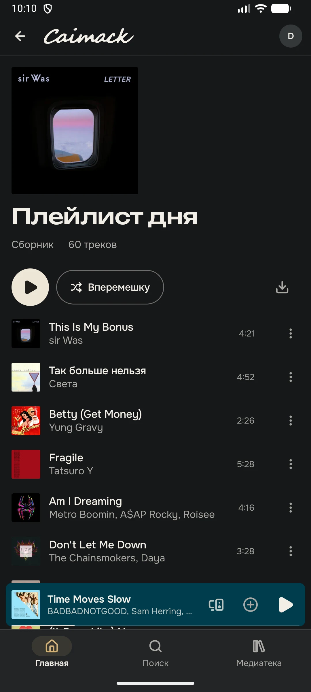

[Documentation](README.md#listen-on-your-devices)

# Android downloads

Download individual tracks, albums, or playlists in the native Android app.
Use [full library synchronization](android-library-sync.md) to copy your entire
music collection over your home network.

## Save music for offline listening

| What to download | Where to find the control |
| --- | --- |
| A track | Open its **⋮** menu and choose **Download**. |
| An album or playlist | Use the download button next to the playback controls. |
| Audiobooks | Download each book from [its own menu](audiobooks.md#listen-and-download). |

  

Use the individual controls when full library sync is inactive. Open
**Library → Downloads** to see progress and available audio. A track's menu
offers **Cancel download** while queued or running, **Retry download** after
a failure, and **Remove download** once complete. Removing a download leaves
the original server file in place.

Configured automatic downloads still run. Opening a page does not download its
audio. A download also leaves your list of saved albums, artists, and playlists
as it was.

## Browse and play offline

- Saved albums, artists, playlists, and folders keep their structure after a
  restart. The app keeps metadata from pages opened online, separately for each
  server and account. Open an older playlist online once to retain its track
  list and order.
- Tracks without a completed offline copy are dimmed. When you start a collection
  offline, the queue contains its downloaded tracks in the same order.
- A track download includes enough metadata to browse its album and credited
  artists. Other pages need a connection the first time you open them.
- **Library → Downloads** includes audio from full library synchronization in
  the storage total. Turning sync off leaves completed copies playable and
  removable from Downloads.

With a saved account, the app opens while it validates the session. If the
server is unreachable, downloaded music remains available. A rejected session
requires sign-in. A validation response that arrives after logout or expiry
cannot restore the old session.

## Artwork and lyrics

Artwork for albums and credited artists is stored alongside download metadata,
separate from the evictable image cache. Missing images are retried on app
startup, resume, and reconnection. Image failures leave audio downloads usable.
Existing images are periodically revalidated, and editing artwork requests an
immediate refresh. If the server is unavailable, the app keeps the last copy.
The app can import images from the older flat cache on first access.

The app fetches lyrics automatically and keeps text, line and word timing,
and provider credits. It checks incomplete results every 15 seconds, up to
five times per refresh, and upgrades older downloads on startup, resume, or
reconnection without downloading the audio again. Failed requests keep the
saved text, and manual lyrics are preserved. When a source has only line
timing, the app highlights lines. See [how Caimack finds lyrics](lyrics.md).

## Sync your listening activity

The app queues listening, skips, likes, unlikes, and new recommendation rules
for the signed-in account, including actions from downloaded playlists. The
queue survives restarts. When the app reaches an updated server, it sends these
actions with the same receipts used by full library sync. The server then
updates the recommendation profile. The lightweight identity endpoint requires
an updated server.

Editing the catalog and personal folders in individual-download mode requires
the server. Audio, metadata, and artwork stay in the app's private storage.
Use the [desktop client](desktop.md#library-synchronization) to export a
synchronized music library to a regular folder.
