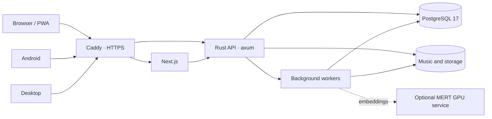

[Documentation](README.md#develop-and-release)

# Development

Run these commands from the repository root unless a command changes
directories. Run `make` or `make help` to list the available targets. Use a
Bash-compatible shell to run the development, check, and build targets.

## Requirements

| Tool | Used for |
| --- | --- |
| Rust 1.94 or later, rustfmt, Clippy, and `sqlx-cli` with PostgreSQL support | Backend, migrations, and Rust checks |
| ffmpeg on `PATH` | Local audio processing and Rust tests that use fixtures |
| Node.js 24 and npm | Web and desktop tools, matching CI |
| Docker with Compose v2 and GNU Make | Local PostgreSQL, development services, and shortcut targets |
| JDK 25, Android SDK 37, and the Gradle wrapper | Android builds and device tests |

The [Android release workflow](../.github/workflows/android-release.yml) records
the Java and Android SDK setup used by CI.

## Run the web app and API

Create the backend environment and set `JWT_SIGNING_KEY` and `OWNER_PASSWORD`
in `backend/.env`.

```bash
cp backend/.env.example backend/.env
```

Then start the API.

```bash
make backend
```

`make backend` starts the local PostgreSQL container, applies migrations, and
runs the API at `http://127.0.0.1:5199`. In another terminal, start the web app.

```bash
npm ci --prefix frontend
make frontend
```

Open `http://localhost:3000`. To use MERT locally, set
`RECOMMENDATIONS_ENABLED=true` and `MERT_URL=http://127.0.0.1:8090` in
`backend/.env`, run `make mert`, and restart the API. The development MERT
service uses NVIDIA, builds the image on first use, and caches weights in
`storage/models/mert`. To rebuild its dependencies, run
`docker compose -f docker-compose.dev.yml build mert`. In Git Bash on Windows,
use `make SHELL=sh mert` and `make SHELL=sh backend`. See [MERT](mert.md) for the
download and idle worker lifecycle.

### Use an existing backend

Point the development proxy at a Caimack server to work on the web app with its
catalog and an existing account.

```bash
cd frontend
npm ci
BACKEND_INTERNAL_URL=https://music.example.com npm run dev
```

In PowerShell:

```powershell
cd frontend
npm ci
$env:BACKEND_INTERNAL_URL = "https://music.example.com"
npm run dev
```

Open `http://localhost:3000` and sign in with an account on that server.
Development requests to `/api/*` go to the configured backend. Library edits
and playback history are saved to that account.

## Run checks

| Command | Checks |
| --- | --- |
| `make check` | Rust and web formatting, lint, and tests |
| `npm run typecheck --prefix frontend` | Next.js route types and TypeScript |
| `make test-db` | Rust workspace tests with all features and local PostgreSQL |
| `make sqlx` | Refresh checked SQL metadata after adding or changing a query |

Initialize the local services and install dependencies before running checks
that use them. The [backend CI workflow](../.github/workflows/backend-ci.yml)
uses disposable PostgreSQL and `SQLX_OFFLINE=true` for compilation. That flag
uses checked-in SQL metadata and still allows database-backed tests to connect.
The Deezer and LRCLIB live tests are opt-in.
[Database migration and test procedures](../db/README.md)

## Music integration modules

Default builds include Yandex Music and VK Music. An administrator can enable
an available provider in **Settings → Experimental** when both the web and
server builds include it. VK requires the
[browser extension](../extensions/vk-music/README.md).

The web build discovers manifests under `frontend/src/integrations`. Use
`CAIMACK_INTEGRATIONS` to select comma-separated module IDs. An empty value
excludes all modules. The API uses Cargo features `integration-yandex` and
`integration-vk`.

To build with VK only:

```bash
(cd frontend && CAIMACK_INTEGRATIONS=vk npm run build)
(cd backend && SQLX_OFFLINE=true cargo build --locked -p api --no-default-features --features integration-vk)
```

For a backend without integrations, use `--no-default-features` by itself.

## Build and test the clients

- **Android.** Configure [local signing](android-release.md#sign-a-local-build),
  then run `make apk` for
  `android/app/build/outputs/apk/release/app-release.apk`.
- **Desktop.** See [build and test](desktop.md#build-and-test) for the Electron
  commands and platform packages.

Run connected Android tests in the separate `app.caimack.uitest` app so test
cleanup leaves the installed application, account, and downloads intact.

```bash
cd android
./gradlew connectedDebugAndroidTest -PcaimackIsolatedUiTests=true
```

Gradle rejects connected UI tests without the isolation flag. Build the normal
APK without the flag. The
[synchronization guide](android-library-sync.md#protocol-and-verification)
lists focused device tests for the offline pipeline.

## Architecture

Web, Android, and desktop clients connect to the same Caimack server. In the
standard deployment, Caddy serves the web app and forwards API and playback
event requests to the Rust backend. PostgreSQL stores application state.
Music, artwork, and stream caches live in mounted storage.



### Source layout

| Directory | Responsibility |
| --- | --- |
| [backend](../backend) | Rust API, SQLx, background jobs, ffmpeg HLS, cue analysis, Chromaprint, metadata lookup, and the in-memory recommendation index. |
| [frontend](../frontend) | Next.js and React web app using TanStack Query and hls.js. The service worker caches the app shell, artwork, and stream segments. |
| [android](../android) | Kotlin with Jetpack Compose and Media3 for playback, downloads, Android Auto, and the radio quick-settings tile. |
| [desktop](../desktop) | Electron packaging, desktop services, and offline storage for Windows and Linux. |
| [db](../db/README.md) | Numbered PostgreSQL migrations applied by `caimack migrate`. The API checks the schema at startup. |
| [deploy](../deploy) | Caddy configuration and optional LAN monitoring. |

### Playback history contract

Web and Android report cumulative `listenedSeconds` alongside `playbackPosition`
in `POST /api/history`. A seek can change playback position without adding
listening time. Deploy matching web and Android clients with a backend that
requires the field. See [Listening stats](listening-stats.md) for how the
server aggregates progress reports.
