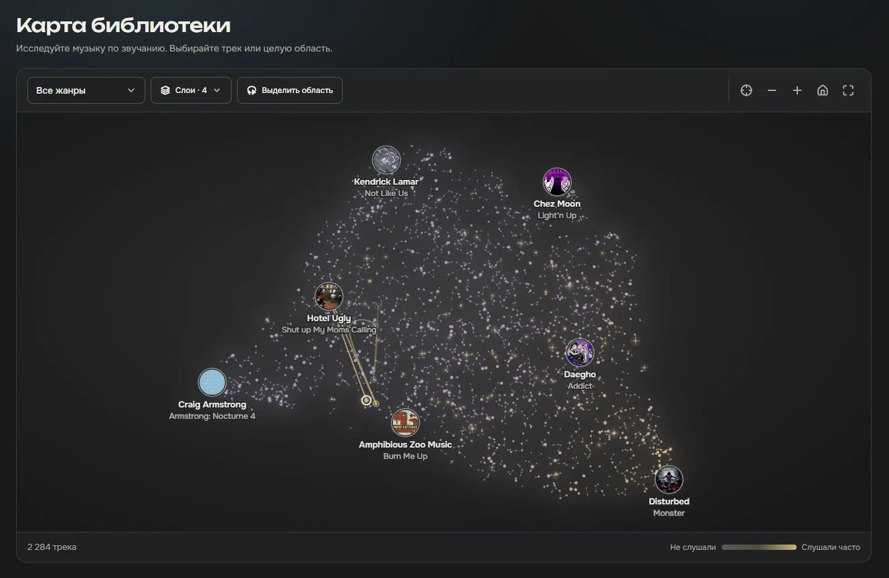

[Documentation](README.md#music-library)

# Library map

Tracks that sound alike appear close together on the map. Select an area to
listen to its tracks, or choose a track to start radio from it. The map needs
the [recommendations module](mert.md) and audio embeddings computed on the server.

## Which tracks appear

The API projects the current recommendation index into two dimensions. It
includes successful embeddings that match the current model, window strategy,
dimension, and audio hash. The mapped count can be lower than the library count
while analysis is still running.

## Saved coordinates

Migration `0017_library_map.sql` adds a PostgreSQL cache shared by API instances.
It stores full-precision coordinates, track IDs and SHA-256 fingerprints of the
normalized audio vectors. The cache key includes the layout version, model and
window strategy. Change `LAYOUT_VERSION` in `recommendations/map/persistence.rs`
when changing projection semantics or the saved representation.

The first request after an API restart restores the saved map. An identical set
of track IDs and vectors reuses its coordinates without optimization or a cache
write. Changes to titles, genres, popularity or listening history do not move
points. An index that has not loaded yet never overwrites the saved map.

## Rebuild rules

- Removing tracks preserves every surviving coordinate, even in a tiny library.
- If at least 80% of the current tracks have saved coordinates for the same
  audio vectors, they are fixed anchors. New or changed tracks are initialized
  near their saved audio neighbours and optimized for 80 epochs. Anchors retain
  their exact coordinates; the map is not normalized again.
- With fewer than 80% unchanged anchors, the projection starts afresh from PCA
  with a fixed seed and stable index ordering, using 400 epochs (200 above
  10,000 tracks). One to three tracks use the simple initial placement.
- Changing an audio vector invalidates that track's anchor even if its ID stays
  the same. A different model, strategy or layout version starts a separate map.

Changed maps are saved in one transaction. A transaction advisory lock prevents
concurrent API instances from building and writing the same cache simultaneously.
Invalid cache payloads are discarded and rebuilt.

While a background update runs, the API serves the previous map with
`updating: true`. The frontend checks every 15 seconds while the map is empty
or updating, and every minute while a nonempty map is still missing tracks.
The visible camera is preserved when coordinates update; the home button fits
the new map.

Separated audio clusters can still form islands. Stable coordinates prevent
incidental movement; they do not force unrelated clusters into one connected
shape. Different libraries can still have different projections.
